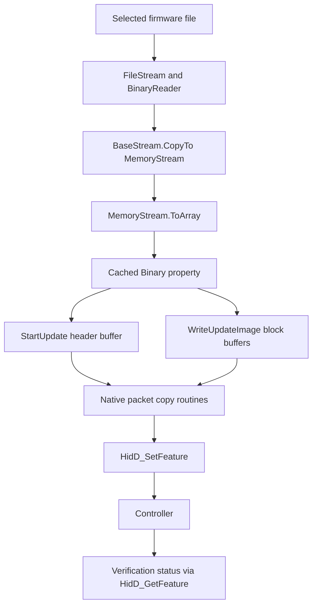

# Sony updater file to USB trace

PlayStation Accessories 2.2.1.2 passes the firmware container through its
recovered file-loading and transfer path without a decryption stage. REA and
Ghidra now work locally, and a static decoder recovers the managed application's
hidden update calls. The normal host path does not give us a plaintext
controller program or a way to authorize modified firmware.

The examined files are the hash-pinned application and library from
[the initial investigation](updater-and-hardware.md). No controller connection
was opened and no Sony code was executed in this pass.

## Analysis environment

Ignored `analysis/toolchain/` contains REA 6.7.0 and Ghidra 12.1.4. REA uses
the existing Node 24.11.0; Ghidra uses the existing Homebrew JDK, reporting
26.0.2. Its arm64 native decompiler was built locally. The official Ghidra ZIP
matched the release's SHA256:

```text
ddac49f903da9d5bac833e5cc79395098b9c33cfd3279be5f31bd00387d2d4db
```

The default linker rejected new TAPI architecture names in the macOS 27 SDK.
Linking with Xcode's compiler and its matching macOS 15.5 SDK succeeded.
`rea.py` scopes the toolchain settings to the analysis subprocess; it does not
change shell defaults or register an agent server. Ghidra's provider check and
actual native decompilation passed.

Ghidra's Makefile generates dependencies using `sed`. For this fresh build,
an empty `ghi_opt/depend` and `make -o ghi_opt/depend` avoided that rule. This
works for an initial build with unchanged headers, not incremental dependency
tracking. Java and the native decompiler run as analysis tools; they do not
emulate the Windows updater.

## Hidden managed calls

REA identifies a .NET 8 x86-64 PE/CLI assembly, version 2.2.1.2, MVID
`23d2a0a5-f2fc-4ef4-ca2a-69c61ff431ff`. Its metadata has 2,073 TypeDef rows and
9,613 MethodDef rows. Obfuscated names, flattened control flow and generated
delegates hide calls to the named update methods from ordinary call searches.

Four delegate factories decode metadata coordinates before binding delegates
through reflection. Algebraically reducing their integer expressions gives:

| Coordinate | XOR key |
| --- | --- |
| Delegate type and optional generic context type | `0x3a264fba` |
| Target method in method factories | `0x21f729e2` |
| Target constructor in constructor factories | `0x2e0bc8ac` |
| Backing field | `0x4034cf00` |

These keys unscramble .NET metadata references. They are not controller
firmware encryption or authentication keys.

`trace_updater.py` applies these reductions to constant initializer arguments.
It requires the exact assembly and four factory-body hashes. It never invokes
target reflection methods or evaluates arbitrary CIL. The independent `dncil`
parser cross-checks CIL bytes against REA's original-byte hashes; decoded types
and fields must agree with their enclosing metadata. Unexpected shapes fail.

This recovers **1,719 metadata targets**: 1,395 method initializers, 78
generic-context method initializers, 223 constructor initializers and 23
generic-context constructor initializers. It annotates 12,457 call-edge records,
including internal forwarding edges; that is not a count of runtime calls.
Other indirection and virtual dispatch remain outside this recovery.

REA preserves two source metadata problems: two Module rows where one is
expected, and an invalid Extends index in the final TypeDef. Coverage remains
partial. Selected method bodies are independently checked against original CIL.

## Recovered data flow



| Build-local method token | Recovered role |
| --- | --- |
| `0x06000834` | Selects one of four configured paths by ControllerType; copies the file stream into a MemoryStream |
| `0x06000844`, `0x06000845` | Binary property setter/getter; store and return the byte-array reference |
| `0x06000818` | Update object constructor; copies that reference into field `0x040005e8` |
| `0x0600081b` | Passes an element address from the array to native StartUpdate |
| `0x0600081c` | Passes successive element addresses from the same array to native WriteUpdateImage |
| `0x0600081d` | Calls native VerifyUpdateImage with the controller handle |
| `0x06000820` | Calls native FinalizeUpdate |

The file loader's recovered calls are FileStream/BinaryReader/MemoryStream
construction, BinaryReader.get_BaseStream, Stream.CopyTo, MemoryStream.ToArray
and the Binary setter. The property and update-object assignment preserve the
array reference. Native routines copy the supplied bytes into feature reports.
No cipher stage appears between these operations on this path.

The native declarations are StartUpdate (`0x0600002e`), WriteUpdateImage
(`0x0600002f`), VerifyUpdateImage (`0x06000030`) and FinalizeUpdate
(`0x06000031`). Their encoded references are retained in the generated report.

The loader also extracts a version from the array. Exact configured path strings
and every obfuscated numeric-cache value are not decoded here. Four path slots
are established, but their firmware-family labels are not inferred from switch
order.

## Native transfer and verification

Ghidra confirms the earlier disassembly: StartUpdate packetizes 256 supplied
header bytes; WriteUpdateImage packetizes a supplied 32 KiB block;
VerifyUpdateImage sends operation 2 and polls the device. These are host
semantics, not a dump of the controller verifier.

The selector at native RVA `0x4330` returns 2 for Bluetooth: the exported
IsConnectedWithBluetooth at RVA `0x1350` calls the same selector and returns
true exactly for 2. That identifies the previously unexplained larger packets:

| Transport | Command report | Command size | Maximum payload | Status report | Requested status size |
| --- | --- | --- | --- | --- | --- |
| USB | `0xf4` | 64 bytes | 57 bytes | `0xf5` | 64 bytes |
| Bluetooth | `0xf6` | 547 bytes | 539 bytes | `0xf7` | 8 bytes |

No packets were sent to test these static observations on hardware.
Official managed status names include header CMAC and firmware-body CMAC
failures. Alongside device status handling, they support the existing inference
of keyed device-side update authentication. They do not reveal keys or the boot
chain. Packet CRCs and host return-value patches do not provide those keys.

## Crypto references and remaining questions

A separate obfuscated helper contains CreateDecryptor/CryptoStream calls and
algorithm-selection references including AES, DES and others. The subsequent
[host crypto and recovery investigation](crypto-and-recovery.md) reconstructs
its resource wrapper and compression variant, recovering a resource-only .NET
assembly, 2,560 strings and a numeric cache. This resolves the identified helper
as host resource protection; it does not establish a controller firmware key.
The recovered firmware loader still uses the stream-copy path above.

A plaintext controller dump, boot ROM information or a demonstrated debug
entry remains directly relevant to executing our own program. An older official
updater could expose additional diagnostics or format details. Brainfuck and
FUZIX platform work still needs an actual code-execution route and recovery
evidence; the follow-up records those milestones.

## Reproduction and evidence

The local CLI requires no agent registration:

```sh
python3 research/dualsense/rea.py doctor --provider ghidra --json
python3 research/dualsense/rea.py inspect-managed-members \
  "$PWD/research/dualsense/analysis/followup/payload/Data1/playstationaccessories.dll" \
  --json > research/dualsense/analysis/followup/managed-members.json
python3 research/dualsense/trace_updater.py
python3 research/dualsense/test_trace.py -v
```

The cross-check dependency is `dncil==1.0.2`, installed in ignored
`analysis/toolchain/python/`. `analysis/followup/trace/` contains recovered
metadata coordinates, annotated call edges and full CIL listings for selected
methods. REA evidence and native decompilations remain in `analysis/followup/`;
hashes and compact findings are in `trace-findings.json`. Original Sony files
remain unchanged.
